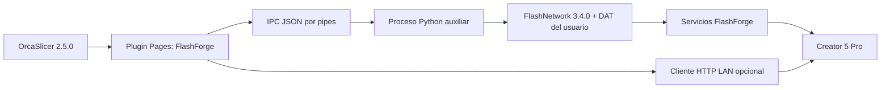

# Análisis de integración

**Actualización:** la integración activa usa solo la capacidad Pages del plugin y no modifica OrcaSlicer. La descripción del diálogo acoplado al host es histórica; la decisión vigente está en la última sección.

Fecha: 2026-11-13. Máquina objetivo indicada por el usuario: FlashForge Creator 5 Pro. Preferencia: usar OrcaSlicer actualizado en Linux y conservar la conexión normal de la impresora.

## Evidencias y versiones

Los commits completos están fijados en `upstreams.lock.json`.

1. [OrcaSlicer 2.5.0](https://github.com/OrcaSlicer/OrcaSlicer/tree/40ecc66f78ed72dc368e0c1ebe40d77f00cc8a19) tiene un sistema real de plugins Python: `orca.plugin`, `orca.base` y `orca.register_capability`. No se requiere parchear el ejecutable para registrar una página.
2. [PagesPluginCapability.cpp](https://github.com/OrcaSlicer/OrcaSlicer/blob/40ecc66f78ed72dc368e0c1ebe40d77f00cc8a19/src/slic3r/plugin/pluginTypes/pages/PagesPluginCapability.cpp) expone `PagesPluginCapabilityBase`, `get_ui`, `on_message` y `post_message`. La página usa `window.orca.postMessage` y `onMessage`; no presupone los métodos de configuración de otras superficies.
3. [PluginLoader.cpp](https://github.com/OrcaSlicer/OrcaSlicer/blob/40ecc66f78ed72dc368e0c1ebe40d77f00cc8a19/src/slic3r/plugin/PluginLoader.cpp) admite instalación local `.py` y `.whl`. Se entrega un wheel con un único paquete superior, `orca_flashforge`, que coincide con el nombre normalizado de la distribución. No se entrega un ZIP que ese instalador no pueda abrir.
4. [Flashforge.cpp](https://github.com/OrcaSlicer/OrcaSlicer/blob/40ecc66f78ed72dc368e0c1ebe40d77f00cc8a19/src/slic3r/Utils/Flashforge.cpp) ya implementa descubrimiento, consulta `detail`, lectura de ranuras y subida `uploadGcode` por HTTP en 8898. El código también implementa un protocolo antiguo en 8899; no deben confundirse.
5. El árbol de perfiles de OrcaSlicer ya contiene Creator 5 y Creator 5 Pro. No se deben inventar perfiles nuevos ni valores de calibración como condición para desarrollar la integración del dispositivo.
6. [Orca-Flashforge main](https://github.com/FlashForge/Orca-Flashforge/tree/c45cc8216c184574c36873314ae7caea67c7a1ad) exige FlashNetwork 3.0.0. Es una referencia más antigua que la instalación local encontrada. Analizar solo `main` llevaría a elegir un ABI incorrecto.
7. [Orca-Flashforge develop](https://github.com/FlashForge/Orca-Flashforge/tree/ea9a451f89d2be656df0445388d6237319db91d4) exige **3.4.0** en `FlashNetworkIntfc.cpp` y usa `FLASHNETWORK9.DAT`. Coincide con la versión obtenida al invocar únicamente `fnet_getVersion` en la biblioteca local de Flash Studio.
8. La cabecera conserva un comentario `// 3.0.0` junto a `fnet_getVersion`; la comprobación efectiva en `FlashNetworkIntfc.cpp` es la evidencia usada para escoger 3.4.0.
9. Las ramas `release_0715` y `release_0730` exigen 3.4.1; `release_0817` exige 3.4.3. Se investigaron como referencias, pero no se admiten sus bibliotecas sin validar antes sus estructuras.

## Conexión normal

En Flash Studio, la cuenta usa tokens y operaciones WAN. La integración pública pasa por las funciones `fnet_getTokenByPassword`, `fnet_refreshToken`, `fnet_getWanDevList` y `fnet_getWanDevProductDetail` del SDK. Los controles posteriores y los eventos usan además una conexión MQTT mediante `fnet_createConnection`, suscripciones y `fnet_connectionSend`.

La biblioteca contiene la implementación del protocolo. El repositorio ofrece cabeceras y consumidores, pero no el código fuente de esa implementación. Por tanto, la primera ruta para conservar la conexión normal es reutilizar el SDK del fabricante en un proceso auxiliar. Reescribir toda su nube como cliente independiente exigiría documentar autenticación, regiones, contratos HTTP, cifrado y MQTT con evidencias adicionales.

Actualización: la opción experimental implementa login, renovación, lista y detalle mediante HTTPS en el auxiliar, usando los servicios de autenticación y máquina autorizados por el usuario. Una consulta de lectura con su cuenta real devolvió una impresora, seis lecturas de temperatura y cuatro ranuras. Las respuestas no se guardaron. Cámara, MQTT y envío aún requieren el SDK original; no se han ejecutado acciones físicas. La restauración y rotación de sesión experimental requieren validación real adicional.

La capa experimental de almacenamiento solicita dos URLs firmadas y sube archivos con `PUT` en bloques, con cancelación. La creación del trabajo y el despacho MQTT QoS 1 están conectados a la página y al agente nativo. Se comprobó la forma de la autorización y la configuración MQTT contra el servidor real sin subir archivos ni emitir órdenes; el recorrido completo se ha probado con dobles. No se ha validado una impresión real. El SDK configurado usa MQTT sobre WebSocket `ws://` en el puerto 8083, sin cifrado TLS; la implementación experimental reproduce ese transporte y sus credenciales temporales viajan por esa conexión. Se registró una relación de cliente con la cuenta para investigar este flujo; no se cambió la vinculación de la impresora.

El adaptador usa consultas WAN del SDK. No cambia el modo de red ni vuelve a vincular la impresora. Tampoco emite `syncLogin` de MQTT. El perfil de cuenta se consulta con `getUserProfile`; si falla, el login mantiene la sesión y muestra la identidad introducida. Al confirmar un envío se ejecutan `bindAccountRelp`, `getMqttConfig` y `fnet_createConnection`, como en el consumidor público. Esa relación de cliente no es `bindWanDev`: no se cambia la vinculación de la máquina. Falta validar con el servidor real si se necesitan pasos adicionales.

El SDK recibe el identificador de aplicación 31 y plataforma 15, los valores usados por el bloque no Windows de `MultiComMgr::setMaintainThdReqHeader`. El User-Agent identifica este proyecto como `OrcaFlashForge`. No se han añadido credenciales de cliente, dominios cloud ni claves extraídas del fabricante al código.

## Arquitectura creada

El proceso auxiliar contiene los tokens y la biblioteca nativa. Las llamadas se serializan. Cada llamada tiene un plazo; si el proceso falla o se bloquea, la página informa del error y descarta la sesión. Al abrir una cámara HLS, el auxiliar sirve únicamente la página del reproductor en `127.0.0.1`, con puerto y ruta aleatorios. No recibe ni registra la URL de vídeo ni credenciales: el panel pasa la URL en memoria al reproductor con `postMessage`. El servidor termina con el auxiliar. Esta página con origen local permite usar MediaSource en WebKitGTK, que bloquea `blob:null` desde el documento `file://` de OrcaSlicer.

En modo cuenta, al solicitar la cámara se envía `FNET_CONN_WRITE_CAMERA_STREAM_CTRL` con acción `open`, ruta de dispositivo recibida de la cuenta y QoS 1, siguiendo `PrinterCameraPanel.cpp` y `ComWanConn.cpp` del fabricante. La comunicación MQTT continúa en el proceso aislado. El vídeo HLS se reproduce con hls.js 1.5.6 o, si no está disponible MediaSource o falla, se intenta la reproducción nativa. La ruta hls.js necesita CORS y un códec compatible. El comando y sus estructuras se prueban con un SDK simulado; falta validar la activación y el vídeo con la impresora real.

La lectura periódica usa un hilo `FlashForge-status` y una petición `status` con `background=true`, cuya respuesta `status_refresh` está separada de las acciones de la página. Se conserva el alias `refresh_status` para páginas anteriores. Cada respuesta incluye el identificador de la consulta, el destino y el modo. No emite el `done` genérico ni cambia el estado de una acción en curso. El bloqueo compartido se libera antes de comunicar el resultado; si ya había una operación, se devuelve una lectura omitida sin tocar ese bloqueo. La interfaz mantiene disponibles sus controles durante las lecturas y conserva una acción explícita hasta que termine la consulta. Descarta respuestas de otro destino, modo o instancia de la página y no reconstruye los selectores en cada actualización. Las llamadas nativas siguen serializadas en el mismo auxiliar; no se crea una segunda sesión del SDK para obtener paralelismo.

La configuración anuncia `status_protocol=1` para detectar una página nueva que esté hablando con un módulo antiguo todavía cargado en memoria. La restauración de cuenta usa un estado independiente de las acciones del usuario; un `config` atrasado no vuelve a bloquear la interfaz tras un `done`. Se solicita la primera lectura al recibir configuración, sesión y dispositivos. Si falta la configuración o la restauración no terminó, se consulta de nuevo ese estado de forma local. Una respuesta perdida tiene un plazo local de recuperación de 65 segundos; al vencer se libera la espera, se descarta cualquier acción pendiente sin ejecutarla y se vuelve a sincronizar la configuración. El receptor JavaScript informa de errores de procesamiento que el bridge nativo podría ocultar.

En un arranque real posterior, el registro de OrcaSlicer mostró un bloqueo de auditoría al abrir `/dev/null` desde el proceso del plugin y que todavía no había agente activo. El lanzador ya no abre ese archivo en el proceso del host: el auxiliar redirige sus propias salidas una vez iniciado. Una prueba con auditoría simulada rechaza cualquier apertura de `/dev/null` en el host y comprueba que el auxiliar puede iniciarse. Falta comprobar el cambio en el OrcaSlicer real.

Observación posterior del usuario: OrcaSlicer se cerró al intentar usar el diálogo nativo. El diario del sistema registra dos abortos `SIGABRT` dentro del ejecutable de OrcaSlicer; al estar desprovisto de símbolos, esos registros no permiten atribuir una causa concreta al host o al plugin. El registro de aplicación también contiene `NetworkAgent::set_user_selected_machine: no printer agent` y `target machine was not found in the current agent's machine list`. En la captura aparecía seleccionada otra impresora local, no la Creator 5 Pro. La opción de agentes está activada y el preset contiene el ID del agente FlashForge, pero esto no demuestra que el agente se haya registrado o seleccionado en ejecución. El diálogo genérico del host y el envío desde previsualización siguen sin validación real; no se debe anunciar que están funcionando.

Análisis posterior del volcado: el proceso abortó por acceso fuera de rango en el vector `physical_extruder_map` de la barra lateral: el perfil tenía cuatro boquillas y heredaba una única entrada. Se corrigió el perfil local usando el mapa identidad que emplea Orca por defecto. El agente repara ese caso concreto al asociar un perfil Creator 5 Pro de cuatro boquillas; no es una asignación de herramientas a ranuras LFS. En una prueba posterior se abrió el proyecto, se conectó la cuenta real y se consultaron las ranuras sin cerrar la aplicación.

Al abrir un proyecto antiguo, su perfil embebido podía seleccionar el agente LAN anterior. El plugin vuelve a aplicar la asociación explícita del perfil tras abrir el proyecto o restaurar la cuenta. En la interfaz real se observó la Creator 5 Pro y sus dos filamentos en el diálogo de previsualización. El diálogo es el genérico de Orca y conserva términos y gráficos Bambu; el agente no envía esos comandos a la impresora.

El host presenta como dispositivo local cualquier agente externo y bloquea su diálogo si no recibe `sdcard=true`. Para este adaptador ese indicador interno representa la disponibilidad de la ruta de subida cloud; no comprueba una tarjeta física ni espacio libre. El resultado efectivo de la subida lo determina el servicio cloud. En la prueba posterior, el diálogo mostró la Creator 5 Pro, las ranuras A1/A2 y el botón «Enviar» habilitado. No se pulsó: el envío y el inicio físicos no se han probado.

La página normaliza una lista limitada de campos. No envía respuestas nativas completas al HTML. No escribe contraseñas ni tokens en configuración, argumentos de proceso o registros propios. La contraseña cruza el bridge local y el pipe para iniciar sesión. Python no garantiza el borrado inmediato de todas las copias en memoria; no se afirma esa garantía.

Por petición explícita del usuario, ahora se puede conservar la cuenta en el llavero del sistema. Solo se guarda el token de renovación y el nombre de acceso mediante `secret-tool`, con los atributos `application=org.orca-flashforge` y `purpose=refresh-session`. El secreto se entrega por stdin y se recupera capturando stdout dentro del auxiliar; no atraviesa el IPC de retorno al plugin. No se guarda la contraseña ni el token de acceso. El callback que recibe cada token nuevo actualiza la entrada del llavero, incluidas las renovaciones automáticas.

La restauración se inicia al cargar el plugin si la preferencia está activa y el SDK está configurado. Un token rechazado se elimina; errores de red o de carga del SDK no borran una credencial guardada. Si no se puede guardar, se informa de que la conexión actual solo es temporal. También se comprueba que la cuenta recuperada coincida con el último nombre de acceso elegido, para evitar recuperar una entrada antigua de otra cuenta tras un fallo de guardado. Salir desactiva primero la reconexión en configuración y después intenta borrar la entrada; un error no se presenta como un borrado correcto.

En este equipo se ha añadido únicamente el permiso D-Bus de usuario `--talk-name=org.freedesktop.secrets` al Flatpak oficial. Una entrada ficticia, con un propósito único de prueba, se guardó dentro del sandbox, se recuperó desde un segundo proceso y se eliminó. No se consultaron otras entradas del llavero ni se usaron credenciales reales. La restauración del servidor y la rotación de tokens se probaron con el SDK C++ simulado.

La alternativa LAN requiere las credenciales que acepte el firmware. No se afirma que funcione en modo normal: eso debe comprobarse en la máquina. En LAN, la URL de cámara se restringe al host configurado. En WAN, la URL procede del SDK y se aceptan solo HTTP/HTTPS sin usuario ni contraseña embebidos. Una URL firmada puede contener un token temporal; se conserva en memoria y no se registra por este código.

## Matriz funcional

| Función | Evidencia pública | Implementación inicial | Validación real |
| --- | --- | --- | --- |
| Página dentro de OrcaSlicer | API Pages 2.5.0 | Implementada | Capacidad cargada; WebView pendiente |
| Inicio de sesión normal | `fnet_getTokenByPassword` | SDK aislado | Pendiente de cuenta |
| Renovación de sesión | `fnet_refreshToken` | Implementada | Simulada |
| Recordar cuenta | Secret Service y `fnet_refreshToken` | Solo token de renovación en el llavero | Llavero real con entrada ficticia; SDK simulado |
| Impresoras de la cuenta | `fnet_getWanDevList` | Implementada | Simulada |
| Estado, trabajo y temperaturas | `fnet_getWanDevProductDetail`, `detail` | WAN y LAN | Simulada |
| Materiales | `fnet_dev_detail_t`, `matlStationInfo` | Lectura | Simulada |
| Cámara | `cameraStreamUrl` | hls.js para HLS en WebView compatible con MSE, con alternativa nativa; MJPEG | Pendiente de validación con la cámara real |
| Descubrimiento LAN | `Flashforge::discover_printers` | Pendiente; IP manual | — |
| Enviar y comenzar por LAN | `uploadGcode` y `printNow` | Existe en OrcaSlicer; no se duplica en el plugin | No validado aquí |
| Cuenta e identidad visual | `fnet_getUserProfile`, `headImgUrl` | Implementada en FlashForge | Simulada |
| Asociación perfil/dispositivo | Lectura de `orca.host.preset_bundle` | Pareja guardada por el plugin | Simulada |
| Agente y sincronización LFS | `PrinterAgentBase`, `PrintParams`, `DevFilaSystemParser::ParseV1_0` | Registrado con ID propio, sesión compartida y lectura `Pull` | 71 pruebas totales; contrato simulado; carga nativa pendiente |
| Enviar y comenzar por nube | `fnet_wanDevSendGcodeClound`, `fnet_wanDevAddCloundJob`, `FNET_CONN_WRITE_START_CLOUND_JOB` | Implementado en la página | Simulada; inicio físico pendiente |
| Pausa/reanudación/cancelación | `FNET_CONN_WRITE_JOB_CTRL` | Pendiente de MQTT | — |
| Calentar, ventiladores y luz | Tipos `*_CTRL` del SDK | Pendiente | — |
| Movimiento y homing | `MOVE_CTRL`, `HOMING_CTRL` | Movimiento relativo de 1 mm mediante SDK original, con confirmación y comprobación `moveCtrl`; homing pendiente; cliente experimental pendiente | Sin movimiento físico de prueba |
| Materiales y carga/descarga | `MATL_STATION_CTRL`, `INDEP_MATL_CTRL` | Pendiente | — |
| Historial de impresiones | Sin contrato de historial identificado | Pendiente | — |
| Grabaciones timelapse | `fnet_getWanDevTimeLapseVideoList` | Consulta en SDK y cliente experimental, primera página | Consulta real experimental: lista vacía; reproducción pendiente |
| RFID y funciones avanzadas C5 Pro | Revisar capacidades del equipo y SDK | Sin equivalencias inventadas | — |
| Compatibilidad simultánea con Flash Maker | Depende de sesiones y firmware | No se cambia LAN Only | Pendiente |

## Qué falta para paridad

Se ha añadido `FlashForgePrinterAgent`, con ID propio `org.orca-flashforge.cloud`, usando `orca.printer_agent.PrinterAgentBase`. Comparte la sesión de la página y su bloqueo de operaciones. Los puntos de entrada `start_print`, `start_local_print` y `start_local_print_with_record` preparan el archivo recibido en `PrintParams.filename`, conservan `plate_index` (que `PrintJob.cpp` entrega comenzando en 1), validan el destino asociado y llaman a la misma subida/creación/entrega MQTT. Los callbacks notifican progreso y errores; la cancelación se consulta mientras la llamada nativa está activa y llega al pipe del auxiliar. No se anuncia éxito sin `dispatched`; no se llama al callback de espera como si se hubiese verificado el inicio físico.

`GUI_App::select_machine` representa agentes externos como conexiones locales y crea el dispositivo desde `print_host`. El botón de configuración del plugin aplica una transacción al perfil activo: agente propio, ID de dispositivo en `print_host` y puerto/clave de host vacíos. No se inventa una URL cloud ni se usa el ID como endpoint. El código local genérico que OrcaSlicer entrega a agentes externos no interviene en la autenticación FlashForge. La cuenta sigue dentro del auxiliar y no se cambia el modo de red de la máquina. Hay que mantener activada la preferencia experimental `use_printer_agents`; con ella desactivada ese `print_host` no es una configuración válida para el envío de hosts antiguo.

El host crea inicialmente el dispositivo con el nombre del modelo del preset, pero el diálogo compara con el `model_id` del fabricante. Para la pareja confirmada `Creator 5 Pro` de la cuenta y `Flashforge Creator 5 Pro` del preset, el agente publica `printer_type=Flashforge-Creator-5-Pro`, el `model_id` de `resources/profiles/Flashforge/machine/Flashforge Creator 5 Pro.json`. No se asigna este identificador a otros modelos. La publicación es una corrección de identidad para el diálogo; no transforma comandos ni cambia la conexión MQTT. Se ha probado con un doble del host; falta observar el diálogo nativo con el dispositivo real.

En la previsualización, `PrintJob` usa `start_send_gcode_to_sdcard` con `project_name=verify_job` y callbacks vacíos como comprobación previa de conexión local. El agente identifica solo esa consulta, comprueba que el destino pertenece a la sesión y solicita su estado; no sube el archivo de prueba. Las peticiones reales de «solo enviar» siguen rechazadas: no se ha comprobado que el flujo cloud conserve el archivo en la máquina sin arrancar. La impresión directa continúa por `start_local_print` o `start_print`, con el backend configurado. Validado mediante dobles; falta verificar el diálogo nativo y una impresión real.

El agente consulta el estado en segundo plano y traduce la respuesta al formato de presentación que consumen los callbacks nativos y `DevFilaSystemParser::ParseV1_0`, siguiendo el adaptador Moonraker fijado. Solo publica firmware recibido y estados conocidos; no inventa versiones ni temperaturas. `get_filament_sync_mode` devuelve `Pull` y `fetch_filament_info` realiza una lectura. Los mensajes de control Bambu no se reenvían al SDK. Descubrimiento SSDP, vinculación de cuenta y envío a SD sin imprimir se rechazan como no implementados.

El LFS conserva sus `slotId` reales en una tabla inversa. Las unidades nativas de cuatro posiciones son una presentación de Orca, no una afirmación sobre la arquitectura de la impresora. Se conservan ranuras vacías y se rechazan IDs duplicados o inválidos. El límite de 16 ranuras de esta vista nativa es local; la página mantiene las ranuras normalizadas por el adaptador. La consulta periódica no sustituye silenciosamente el mapeo sincronizado: cambios de bobina o topología exigen una nueva sincronización. Al enviar se comprueba de nuevo el material y presencia, además de las comprobaciones del auxiliar justo antes de la escritura.

La página también consulta las ranuras al preparar el archivo. Lee `filament_type` y `filament_colour` del G-code, incluidos los G-code de la placa seleccionada de un 3MF. Solo propone asignaciones con material y color iguales y una única ranura ocupada. No crea herramientas a partir de estos metadatos ni inventa herramientas para archivos sin comandos T. La confirmación del usuario se conserva. Detectar un material no proporciona sus temperaturas o un perfil de calibración del fabricante.

La revisión de impresión pide confirmar físicamente cada filamento asignado. Si se cambia una bobina, el usuario actualiza su tipo y color en la impresora y vuelve a preparar la revisión para consultar las ranuras de nuevo. La página rechaza tipos incompatibles y el auxiliar vuelve a comprobar la ranura antes del envío. Esta interacción no carga ni configura la bobina automáticamente. El envío todavía no está implementado en el backend experimental.

La validación del agente utiliza un doble del host: registro de ambas capacidades, transacción de configuración, lectura de filamentos, traducción de IDs no consecutivos, cancelación, rechazo de destino/perfil obsoleto y entrega incierta. Una prueba adicional con OrcaSlicer Flatpak 2.5.1 en un perfil separado abortó durante el arranque antes de cargar el plugin; falta observar el diálogo nativo, la sincronización y el envío completo con el host y la impresora reales.

Los contratos de control del SDK tienen detalles que deben mantenerse exactos: `job_ctrl.action` usa `pause`, `continue`, `cancel`; las luces usan `open`, `close`. Los mapas contienen `toolId`, `slotId` y colores separados. No se debe inferir que una ranura equivale a un extrusor: el significado depende del modelo y del G-code.

Las temperaturas normalizadas conservan valores ausentes como `null` en HTTP. El SDK representa sus datos en una estructura numérica; no permite distinguir siempre entre un cero recibido y un cero usado por el SDK cuando falta un campo. La UI no presenta estos valores como mediciones históricas ni calibraciones validadas.

La vista **Boquillas y filamentos** combina temperatura, objetivo, material y color en una tarjeta por boquilla para Creator 5/5 Pro. La relación tiene evidencia en `FFUtils.hpp`/`FFUtils::isNozzlesPrinter` (PID `0x0028` y `0x0029`), `SlotSelectWnd::setupNozzles` de `AmsMappingWidgets.cpp` (boquilla `i+1` con `slotInfos[i]`) y `NewTempInputPanel::UpdateTempatrue` (temperaturas de esa boquilla en `nozzleTemps[i]`). El adaptador conserva el PID recibido y el normalizador añade `filament_slot_id` únicamente con esos modelos, listas completas del mismo tamaño e identificadores de ranura válidos y únicos. Conserva el orden recibido y los IDs originales; no ordena ranuras para emparejarlas. Esta relación es visual y no define equivalencias con herramientas G-code ni cambia el mapeo de impresión. Las ranuras vacías se muestran como **Sin filamento**; si no existe una relación documentada o la respuesta está incompleta, los materiales se muestran aparte dentro del mismo panel.

## Comprobaciones y límites

Las pruebas comprueban HTTP local simulado, errores de autenticación, renovación y liberación de memoria con un SDK de prueba, offsets y tamaños de las estructuras frente a la cabecera C, registro Pages con un doble del módulo `orca` e IPC del proceso auxiliar. Estas pruebas no sustituyen el servidor FlashForge ni la carga real del plugin en el laminador.

Resultado local de esta mejora: 54 pruebas superadas. Incluyen los tamaños y offsets de las estructuras nuevas de envío, callbacks MQTT, liberación de los 14 tipos de eventos, subida/creación/entrega, rechazo de impresora ocupada, errores de cada fase, cancelación durante la llamada nativa, consumo único de la revisión, cambio de perfil/proyecto y selección explícita de placa/herramientas/ranuras. Se mantiene la regresión del audit hook y la distinción entre permisos e intérprete inexistente. La UI se ha probado en el navegador de Orca con cuenta, selector, vínculo al perfil y confirmación de envío simulados, sin errores de consola. No es una validación física ni visual del WebView de OrcaSlicer.

El inicio cloud sigue `WanDevSendGcodeThd::startCloundJob` y `ComWanConn::sendStartCloundJob`: primero subida, después creación y finalmente envío MQTT por el `devTopic` de la cuenta, con `devId`, número de serie y `jobId` devueltos. No basta que el REST acepte el trabajo. Se mantienen callbacks y sus datos vivos hasta parar y liberar la conexión. Una confirmación MQTT acredita la recepción por el servidor, no la entrega a la impresora ni el inicio físico. La interfaz deja ambos sin confirmar. No se reintentan automáticamente las fases de escritura.

La preparación y la impresión son comandos separados. El auxiliar guarda una copia privada del archivo y un identificador de revisión que solo admite un intento. Cambiar el destino o el perfil invalida la preparación en la página. Los archivos y miniaturas temporales se borran al reemplazar el trabajo, después del intento o al cerrar el auxiliar. La cancelación viaja por el pipe a un lector independiente y llega al callback nativo mientras la subida está activa; después de crear el trabajo no se presenta como cancelación de impresión.

En la comprobación inicial, el OrcaSlicer instalado era Flatpak 2.5.0. Se ejecutó `doctor` desde ese sandbox con la biblioteca local; devolvió versión 3.4.0 y compatibilidad con el adaptador. No fue necesario cambiar permisos de Flatpak para esa consulta. Esa comprobación no cubría los permisos propios del sistema de plugins al cargar y ejecutar el wheel.

Actualización del 2026-11-15: se observó la carga nativa de la capacidad FlashForge en OrcaSlicer 2.5.0. Después, con Flatpak actualizado a 2.5.1 (`eef7710c`), una copia instrumentada del wheel en un perfil separado invocó `probe` desde `on_load`, pasando por el hilo de la página y el proceso auxiliar. Devolvió `sdk_version: 3.4.0` y `supported: true`. Se necesitaron permisos de `/dev/null`, del comando completo y de los eventos `FsReadWrite:open` y `FsRead:open` de los canales IPC. El host puede guardar estos últimos tras rechazar el primer intento; hay que repetir la consulta después de concederlos. La validación no incluyó login, impresora real ni reproducción visual de la página. No se cambió ningún permiso global de Flatpak.

La biblioteca instalada se ha consultado solo para conocer su versión. No se han usado credenciales de cuenta, consultado la impresora, cambiado ajustes ni enviado trabajos. El resultado permite comenzar el proyecto con un wheel y componentes concretos, sin afirmar que ya reproduce Flash Studio completo.

La API de páginas no ofrece un gancho para «Imprimir cama»: `Plater::priv::on_action_print_plate` abre directamente `SelectMachineDialog` cuando están activos los agentes. Sustituir ese flujo requiere cambiar el host o ampliar su API de plugins. Ese adaptador se dejó de registrar al pasar al flujo solo con plugin.

## Diálogo propio de impresión (prototipo histórico)

Un parche experimental, conservado solo en `local/previous-host-integration/`, añadió a una copia independiente del host una vista modal de la capacidad Pages. El evento de previsualización usa el G-code temporal de la placa laminada y no abre `SelectMachineDialog` para el perfil Creator 5 Pro. La página y el diálogo comparten la misma sesión, con receptores separados y revisiones identificadas por origen para evitar mezclar mensajes de impresión. La capacidad `FlashForgePrinterAgent` anterior no se registra.

Ese prototipo seleccionaba el dispositivo vinculado o la única Creator 5 Pro recibida, consultaba estado y ranuras, exigía confirmar cada material y entregaba la revisión al proceso auxiliar experimental. Bloquea el envío cuando no se identifican herramientas o no se reciben ranuras. La preparación recibe la ruta y la placa del host; las ignora si llegan como campos del mensaje web. Cambiar proyecto, placa o perfil invalida la revisión. La subida y la entrega siguen sin validación real; MQTT QoS 1 solo confirma recepción por el servidor.

Validación local: pruebas Python con dobles y una vista HTML con cuenta, estado y ranuras simulados. La copia modificada compiló y arrancó con un directorio aislado; el registro confirma la carga de la capacidad FlashForge y el proceso auxiliar se inició. El perfil aislado quedó en el asistente inicial y el control de ventanas de este entorno no estaba disponible: no se comprobó el botón ni la selección real de impresora. No se han realizado acciones físicas.

## Integración solo mediante plugin

La solución activa no parchea el host ni registra el agente que adaptaba ranuras al diálogo genérico. El usuario exporta la placa laminada y revisa el archivo en la página FlashForge. El plugin consulta el estado y las ranuras reales, exige un perfil y dispositivo Creator 5 Pro, confirma cada asignación y utiliza la biblioteca experimental en el auxiliar. Si faltan herramientas o ranuras se bloquea el envío. Se mantienen la invalidación por cambio de proyecto, el progreso de subida y la distinción entre acuse del servidor MQTT e inicio físico.

La biblioteca experimental incluye controles MQTT de luz y apertura de cámara. Los serializadores 3.4.0, ejecutados sin red y con datos ficticios, produjeron `lightControl_cmd` con `args.status` y `streamCtrl_cmd` con `args.action`; ambos admiten los valores `open` y `close` documentados en la cabecera. El destino se obtiene de la cuenta y la confirmación QoS 1 solo acredita recepción por el servidor. Estos controles y la reproducción de cámara no se han validado con la impresora real. El plugin genera vistas opcionalmente mediante una copia temporal 3MF exportada por OrcaSlicer, sin alterar el proyecto.

Para inspeccionar los laminados, el plugin solicita al cargar un permiso de solo lectura para `orcaslicer_<uid>/orcaslicer_model/*` bajo el directorio temporal del usuario. OrcaSlicer conserva ese permiso si se acepta; no se solicita acceso completo. El reproductor local prueba HLS y reproducción nativa para URLs HTTP(S), también cuando la URL no termina en `.m3u8`; las URLs MJPEG explícitas se muestran como imagen. La reproducción real depende de la URL entregada por FlashForge, los códecs y las políticas del WebView y aún requiere validación real.

En la página FlashForge, la selección inicial por orden (filamento 1 a ranura con ID 1, etc.) es una preferencia visual pedida por el usuario, no una equivalencia deducida del protocolo. Puede modificarse y solo se preselecciona si el ID existe. La revisión exige una ranura para cada herramienta, pero por petición del usuario no bloquea por discrepancias de material, color o ranura vacía; tampoco vuelve a comprobar el estado del filamento antes del envío. Los datos de gramos y milímetros proceden de los comentarios del G-code cuando están disponibles.

La cancelación experimental se serializa como `jobCtl_cmd` con `args.jobID` y `args.action=cancel`, cotejada con el serializador 3.4.0 en un proceso offline con datos ficticios. Antes de transmitir se vuelve a leer el estado y se exige el mismo trabajo activo. La confirmación MQTT solo acredita al servidor. No se ha ejecutado una cancelación real. La imagen de estado se usa solamente si la impresora devuelve `printFileThumbUrl`.

En este equipo, el Flatpak GNOME 50 cargaba `libavcodec.so.61` de `/app/lib`, incompatible con `libgstlibav.so` (faltaba `avcodec_get_supported_config`). `codecs-extra` 25.08 ya estaba instalado. Se aplicó exclusivamente a este usuario y aplicación un override Flatpak con `LD_LIBRARY_PATH=/usr/lib/x86_64-linux-gnu/codecs-extra/lib` y `GST_REGISTRY=/var/cache/orcaflashforge-gstreamer-registry.bin`. Una muestra H.264 sintética se decodificó con `avdec_h264` y `fakesink` dentro del Flatpak; la cámara y WebView reales siguen sin validar. Para revertir solo estas variables: `flatpak override --user --unset-env=LD_LIBRARY_PATH --unset-env=GST_REGISTRY com.orcaslicer.OrcaSlicer`.

Información de máquina: `getWanDevDetail` del SDK 3.4.0 busca en la respuesta `cumulativePrintTime`, `cumulativeFilament`, `nozzleModel` y `measure`. El consumidor original `SingleDeviceState.cpp:3804-3820` muestra en WAN las horas y los metros recibidos; la cabecera genérica describe otras unidades, por lo que no se aplica esa interpretación a LAN. Los campos ausentes se muestran como desconocidos. La calibración de flujo es una opción del trabajo, disponible solo si el detalle declara `lidar=1`; la nivelación también se solicita como opción al enviar el trabajo. Ninguna de las dos es una orden de calibración independiente y no se han probado físicamente.

Los archivos G-code guardados se consultan mediante `fnet_getWanDevGcodeList`: el SDK usa `GET /api/v2/external/truck/device/local_files?id=...`. Su parser acepta `data` como lista y extrae `file_name`, `file_obj.url` y `file_detail` con tiempo, peso y herramientas. Se contrastó con el parser 3.4.0 offline usando datos ficticios. Son archivos presentes en la impresora, no un historial completo de trabajos terminados. Para repetir, el SDK solicita `POST /api/v2/external/truck/device/localJob` y después publica `newLocalJob_cmd`; ambos serializadores se ejecutaron offline con datos ficticios para verificar el formato. La página exige revisar las ranuras y la confirmación MQTT no acredita el inicio físico. La consulta y repetición reales siguen pendientes de validar.

Al fallar el vídeo WebKit, el proceso auxiliar puede ejecutar GStreamer con las bibliotecas de códec del runtime en su propio entorno, o FFmpeg si no está disponible ese runtime, para convertir el flujo a MJPEG de hasta doce imágenes por segundo; GStreamer no duplica imágenes cuando la fuente entrega menos. La URL firmada de origen queda en memoria y no aparece en argumentos ni logs: El reproductor recibe una URL temporal de loopback que redirige al origen. El proceso se cierra al ocultar la cámara. Se comprobó con HLS H.264 sintético dentro del Flatpak, sin modificar el entorno de OrcaSlicer, no con la cámara real. El override global `LD_LIBRARY_PATH` y el registro GStreamer de OrcaSlicer se han retirado; no se alteran las bibliotecas ni colores del programa.

El lector WAN original `getWanDevDetail` busca la clave JSON `light` (0xc6058) y guarda su valor en `lightStatus` (offset 472). La biblioteca experimental usa esa correspondencia para mostrar `open`/`close`; si no llega un valor reconocido, el estado sigue desconocido. El reproductor auxiliar limita su afinidad a dos CPU cuando `taskset` está disponible y descarta imágenes atrasadas. El número y la latencia reales dependen también del flujo HLS y la impresora.
